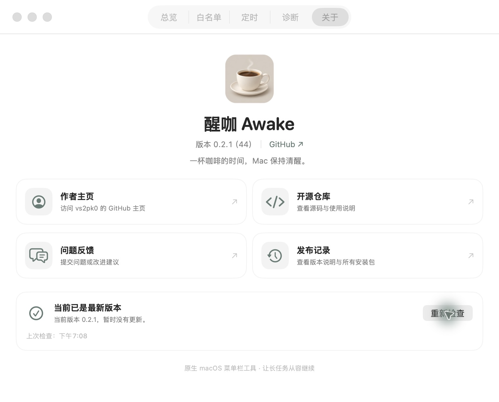
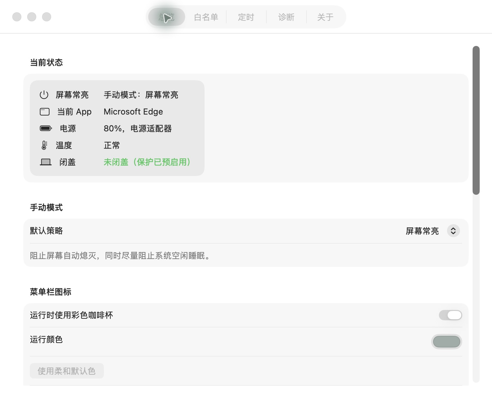
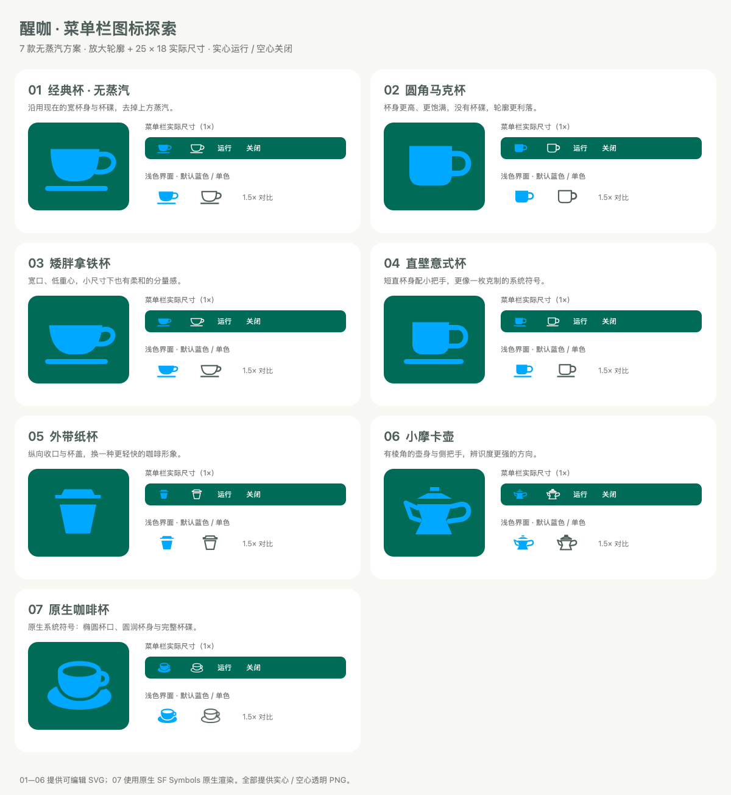
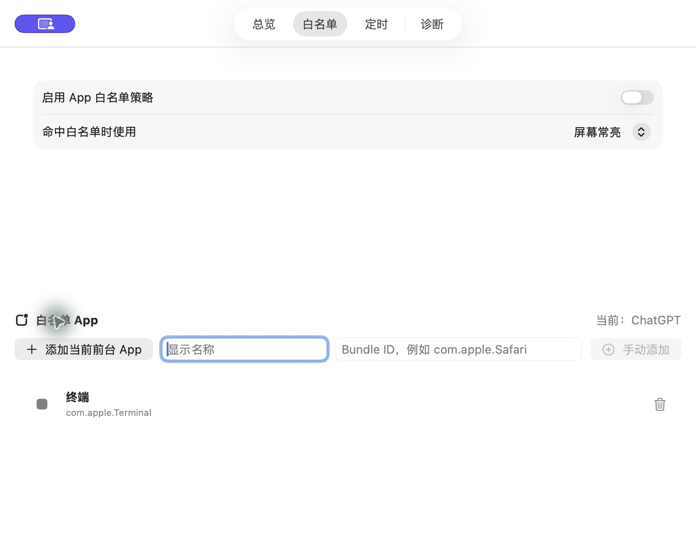
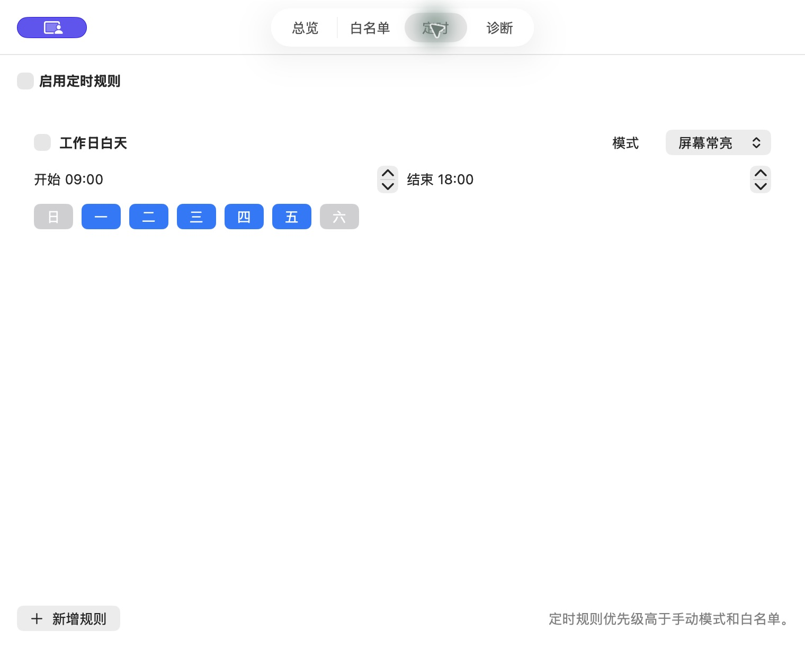
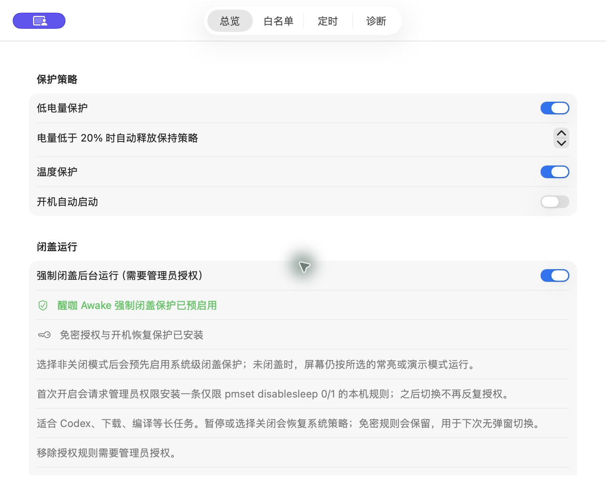

<p align="center">
  
</p>

<h1 align="center">醒咖</h1>

<p align="center">一杯咖啡的时间，Mac 保持清醒。</p>

<p align="center">
  <a href="https://github.com/AI-Good-Tool/Awake/releases/latest">下载最新版</a> ·
  <a href="#快速开始">快速开始</a> ·
  <a href="#界面与功能">界面预览</a> ·
  <a href="#开发与打包">开发与打包</a>
</p>

<p align="center">
  <a href="https://github.com/AI-Good-Tool/Awake/actions/workflows/ci.yml"></a>
  <a href="https://github.com/AI-Good-Tool/Awake/releases"></a>
  
  
</p>

醒咖 是一个原生 SwiftUI / AppKit 菜单栏防休眠工具。下载还没完成、项目正在编译，或正在投屏演示时，让 Mac 按你的规则保持唤醒；任务结束后，单击菜单栏咖啡杯即可暂停。

- **四种模式**：关闭、屏幕常亮、后台运行、演示模式。
- **App 白名单**：指定应用位于前台时才启用保持唤醒策略。
- **定时规则**：按星期和时间段自动切换策略，支持跨午夜。
- **保护策略**：低电量、严重或危险温度下自动释放保持唤醒策略。
- **菜单栏控制**：左键暂停／恢复，右键打开完整菜单；7 款无蒸汽图标可切换，空心与实心区分状态，运行颜色可自定义。
- **闭盖保护与恢复**：可选系统级闭盖后台运行，独立看门进程和开机恢复规则提供保护。
- **本地诊断**：查看异常退出记录、导出当前状态，方便排查问题。
- **关于与更新**：独立关于页与菜单入口，在线检查 GitHub Releases，下载并校验新版安装包。

## 快速开始

### 下载安装

前往 [Releases](https://github.com/AI-Good-Tool/Awake/releases/latest)，选择一种安装方式：

| 文件 | 适合场景 | 安装方法 |
| --- | --- | --- |
| `Awake-<版本>.dmg` | 日常安装，推荐 | 打开 DMG，将「醒咖」拖到 Applications |
| `Awake-<版本>.pkg` | 希望使用 macOS 安装向导 | 打开 PKG，按向导安装到 `/Applications` |
| `Awake-<版本>.zip` | 手动解压安装 | 解压后把应用移到「应用程序」 |
| `SHA256SUMS.txt` | 检查下载文件是否完整 | 在下载目录执行 `shasum -a 256 -c SHA256SUMS.txt` |

**系统要求：macOS 26 或更新版本。** Release 中主应用和安全看门进程均为 Universal 二进制，支持 Apple Silicon 与支持 macOS 26 的 Intel Mac。校验文件同时列出三种安装包；只下载其中一种时，可单独比对该文件的 SHA-256。

当前版本使用 **ad-hoc 应用签名**，尚未配置 Apple Developer ID 签名与公证，PKG 也没有 Installer 证书签名。首次打开可能出现开发者无法验证的提示。确认下载来源为本仓库后，可到「系统设置 → 隐私与安全性」允许打开。

### 三步使用

1. 打开「醒咖」，在菜单栏找到咖啡杯图标。
2. 右键图标 →「打开设置」，选择需要的默认策略。
3. 左键图标可随时暂停／恢复；退出应用会释放保持唤醒策略，并尝试恢复由本应用管理的闭盖设置。

| 模式 | 屏幕行为 | 适合做什么 |
| --- | --- | --- |
| 关闭 | 遵循系统设置 | 结束任务，恢复正常省电行为 |
| 屏幕常亮 | 保持屏幕点亮，并阻止系统空闲睡眠 | 阅读、监控面板、临时展示 |
| 后台运行 | 允许屏幕自动熄灭，阻止系统空闲睡眠 | 下载、编译、同步、长时间运算 |
| 演示模式 | 同时保持屏幕点亮与系统唤醒 | 投屏、会议、演示 |

## 界面与功能

以下为应用的真实窗口截图。图中的「终端」是拍摄时临时添加的白名单示例；新安装不会预置此条目。应用采用清淡的奶油灰咖啡杯图标；菜单栏默认使用蓝色（`#00A8FF`），可自定义颜色，也可点击「恢复默认蓝色」。白名单、定时与保护策略截图展示相同功能，拍摄于 0.2.0。

### 关于与在线更新

「关于」拥有独立标签页，也可从菜单中的「关于醒咖…」直接进入。版本信息、作者主页、开源仓库、问题反馈与发布记录集中在这里。

点击「检查更新」会请求本仓库的 GitHub Releases，不需要 GitHub 登录或 Token。发现更高的正式版本时，可直接下载 DMG；应用会验证安装包大小及 GitHub 发布的 SHA-256 校验值，验证通过后才能打开。下载可取消，检查失败时可重试或前往发布页面。

安装前请先从菜单栏正常退出醒咖，再将新版拖入「应用程序」替换。应用现名为「醒咖.app」；若仍有「醒咖 Awake.app」，安装后可将其移到废纸篓，避免出现两个图标。当前采用下载安装包后手动替换的更新方式，设置会保留。检查仅在主动点击时发起；网络不通或 GitHub 限流时不会影响保持唤醒功能。



### 状态总览

策略来源、当前前台应用、电池与供电状态、温度和闭盖条件集中展示。可以直接切换默认策略，也能自定义菜单栏运行图标颜色。



### 7 款菜单栏图标

0.2.5 起，在「总览 → 菜单栏图标」中点选经典杯、圆角马克杯、矮胖拿铁杯、直壁意式杯、外带纸杯、小摩卡壶或原生咖啡杯。切换立即生效，重启后保留选择；默认使用无蒸汽经典杯。

所有样式运行时显示实心，关闭或暂停时显示空心；可使用默认蓝色、自定义运行颜色，或关闭彩色模式以跟随系统明暗外观。原生咖啡杯使用系统 `cup.and.saucer` 符号。



### 按应用、按时间自动唤醒

在「白名单」中添加当前前台应用，或手动填写应用名称和 Bundle ID。开启后，只有匹配的应用在前台时才使用指定策略。

在「定时」中配置规则名称、星期、开始／结束时间和运行模式。使用工作日 09:00—18:00 等规则前，需要同时启用定时规则总开关与具体条目。

| App 白名单 | 定时规则 |
| --- | --- |
|  |  |

策略优先级为：**低电量／温度保护 → 命中的定时规则 → App 白名单 → 手动模式**。多条定时规则同时命中时，使用列表中最先匹配的规则。暂停会停止当前保持唤醒策略，恢复后重新评估规则。

### 保护策略与闭盖运行

低电量保护默认阈值为 20%；使用电池且未充电时，达到阈值会停止保持唤醒。温度保护会在系统热状态为严重或危险时生效。

默认模式使用 macOS 电源 assertion；**防止空闲睡眠不等于能绕过系统闭盖限制**。标准闭盖运行通常需要外接显示器、外接输入设备及电源，具体行为由 macOS 决定。

可选的「强制闭盖后台运行」会请求管理员授权，安装仅允许切换 `pmset disablesleep 0/1` 的本机规则，并在启用策略时预先应用系统级闭盖保护：

- 暂停、选择关闭或退出时，会尝试恢复由本应用管理的系统睡眠设置。
- 独立 `AwakeWatchdog` 进程在主程序异常退出后尝试恢复系统睡眠。
- 开机恢复规则在启动时重置 `disablesleep`；移除授权规则可在设置内操作。
- 本应用不会自动接管由其他软件开启的闭盖设置。闭盖长任务仍需留意散热、供电与设备摆放，不要将运行中的电脑放入密闭包内。

<details>
<summary>查看保护策略与闭盖设置截图</summary>



</details>

### 本地诊断

「诊断」标签可查看和清除异常退出记录，并导出 `Awake-Diagnostics.json`。导出文件包含当前策略、电源信息、前台应用名称／Bundle ID 和本地异常记录；提交问题前请先检查内容。

本地日志位于 `~/Library/Logs/Awake.log`。程序包含崩溃后的监督恢复与重启次数限制；主动退出不会自动重启。

## 从 Lidwake 升级

先从旧版菜单中正常退出，再安装并打开醒咖：

- 首次启动自动复制旧偏好、白名单、定时规则与闭盖保护归属记录；已有的新应用设置优先保留。
- **开机启动需要在新版设置中重新开启。**
- 新 Bundle ID 为 `com.local.awake`，主程序为 `Awake`，辅助进程为 `AwakeWatchdog`。
- 安全锁、恢复记录目录和已安装的授权文件沿用旧标识，以免遗留保护记录或让两个版本同时控制系统睡眠。
- 内部 Swift 模块暂时保留 `Lidwake` 名称，不影响应用名称与安装包标识。

## 开发与打包

需要 **Xcode 26 或更新版本、Swift 6.2+、macOS 26+**。项目使用 Swift Package Manager，没有第三方 Swift 依赖。

```bash
git clone https://github.com/AI-Good-Tool/Awake.git
cd "Awake"

# 构建 Debug .app 并启动；Codex Run 按钮使用同一入口
bash "./script/build_and_run.sh"

# 运行测试；使用完整 Xcode 工具链
env DEVELOPER_DIR="/Applications/Xcode.app/Contents/Developer" xcrun swift test

# 当前架构的 Release .app 和 ZIP
bash "./scripts/package-local.sh"

# 一次构建 Universal .app，再输出 DMG、PKG、ZIP 和 SHA256SUMS.txt
bash "./scripts/package-release.sh"
```

独立打包可运行 `bash "./scripts/package-dmg.sh"` 或 `bash "./scripts/package-pkg.sh"`。输出均在 `dist/`；应用为 `dist/醒咖.app`。PKG 固定安装到 `/Applications`，不安装额外后台服务，不修改电源设置，也不会启动应用；闭盖授权由用户在应用内单独开启。

运行脚本支持 `--verify`、`--debug`、`--logs` 和 `--telemetry`，后两者查看本地应用日志。品牌、版本与安装包名称在 `scripts/app-config.sh` 中维护，应用 UI 文案在 `Sources/Lidwake/Brand.swift` 中集中维护。

图标画稿为 `Assets/Brand/AppIconArtwork.png`，由内置 imagegen 生成，完整提示词保存在 `Assets/Brand/imagegen-prompt.txt`。`scripts/make-app-icon.swift` 负责添加 macOS 圆角容器与透明留白，并生成 16—1024 像素的 ICNS；`Assets/Brand/AppIcon.png` 是用于文档预览的 1024 像素成品。

## 自动构建与发布

- 推送 `main` 或提交 Pull Request：运行测试与打包脚本语法检查。
- 推送 `v<版本>` 标签：在 GitHub Actions 的 macOS runner 上运行测试，构建 Universal DMG、PKG、ZIP，验证签名与架构并生成校验文件，最后发布到 [Releases](https://github.com/AI-Good-Tool/Awake/releases)。
- 也可在 [Release 工作流](https://github.com/AI-Good-Tool/Awake/actions/workflows/release.yml) 中手动输入已有版本标签重跑。
- 标签必须与 `scripts/app-config.sh` 中的版本一致。全部构建产物就绪后，工作流才将 Release 从草稿发布。

发布新版本时，更新版本号、构建号及 `docs/release-notes.md`，提交并推送后创建对应标签：

```bash
git tag "v<版本>"
git push origin "v<版本>"
```

当前工作流不依赖签名证书密钥；若后续配置正式分发，可在此流程上补充 Developer ID Application / Installer 签名与 Apple 公证。
